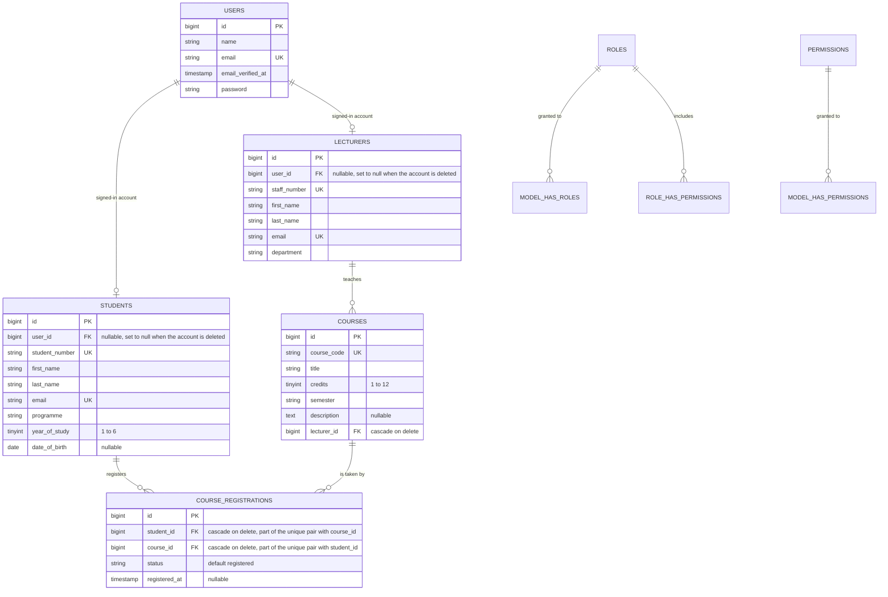

# Student Management System — BUC3131 Coursework Two (2026/2027)

A Laravel 12 web application built for Makerere University Business School, **BUC3131 Advanced Web
Application Development, Coursework Two 2026/2027**. It keeps a register of students, a catalogue of
courses, and the registrations that join the two, and it shows each signed-in person only the part of
that data their role is allowed to see.

Three roles share the one application:

* an **administrator** maintains the register, the catalogue and every registration;
* a **lecturer** reads the courses assigned to them and the students registered on those courses;
* a **student** reads the courses still open to them, registers for them, and cancels their own
  registrations.

Repository: <https://github.com/2400714921/AWAD-CW2>. `main` holds the stable integration, `develop` holds
the coursework as the six questions land, and each member worked on one feature branch that reached
`develop` through a pull request. `CONTRIBUTIONS.md` records who built what.

## 1. What each question asks, and where the answer is

| Question | Marks | Where it is answered | Proof in the test suite |
|---|---|---|---|
| 1 — database schema and relationships | 10 | `database/migrations/2026_11_02_2042*` (`students`, `lecturers`, `courses`, `course_registrations`) and the four models in `app/Models` | `tests/Feature/DatabaseRelationshipsTest.php` (7 tests) |
| 2 — factories, seeders, no duplicates on re-run | 4 | `database/factories/`, `database/seeders/RolePermissionSeeder.php`, `database/seeders/DemoDataSeeder.php`, wired in `DatabaseSeeder` | `tests/Feature/FactoriesAndSeedersTest.php` (13) |
| 3 — accounts, roles, permissions | 6 | Breeze Blade stack, `HasRoles` on `app/Models/User.php`, `app/Policies/`, the `role` and `permission` shortcuts in `bootstrap/app.php`, the guards in `routes/web.php` | `RoleAndPermissionTest.php` (8), `RecordOwnershipTest.php` (7), `tests/Feature/Auth/` (20) |
| 4 — CRUD with validation | 12 | `app/Http/Controllers/{Student,Course,Registration,Dashboard}Controller.php`, `app/Http/Requests/`, the views under `resources/views/{students,courses,registrations}` | `StudentCrudTest.php` (14), `CourseCrudTest.php` (14), `CourseRegistrationTest.php` (13) |
| 5 — layout, components, permission-aware navigation | 5 | `resources/views/layouts/{app,sidebar,navigation}.blade.php`, `resources/views/components/{nav-links,nav-link,alerts}.blade.php`, `resources/views/dashboard.blade.php`, `DashboardController` | `LayoutAndNavigationTest.php` (9) |
| 6 — documentation and contribution report | 3 | this file, `CONTRIBUTIONS.md`, `docs/screenshots/` | — |

## 2. Installing it

PHP 8.2 (written and tested on 8.2.12), Composer, Node.js and a MySQL or MariaDB server.

```bash
git clone https://github.com/2400714921/AWAD-CW2.git
cd AWAD-CW2
composer install
npm install
copy .env.example .env        # cp on Linux and macOS
php artisan key:generate
```

Set the application name and the database in `.env`:

```
APP_NAME="AWAD CW2"
DB_CONNECTION=mysql
DB_HOST=127.0.0.1
DB_PORT=3306
DB_DATABASE=awad_cw2
DB_USERNAME=root
DB_PASSWORD=
```

Create the database, migrate, seed and build the front end:

```sql
CREATE DATABASE awad_cw2 CHARACTER SET utf8mb4 COLLATE utf8mb4_unicode_ci;
```

```bash
php artisan migrate --seed
npm run build
php artisan serve
```

The application is then at <http://localhost:8000>. During development `npm run dev` serves the assets
through Vite instead, in which case `npm run build` can be skipped. `composer run dev` runs the server,
Vite, the queue listener and the log tail together.

## 3. Database setup

`php artisan migrate` builds eighteen tables: Breeze's (`users`, `password_reset_tokens`, `sessions`),
the framework's (`cache`, `cache_locks`, `jobs`, `job_batches`, `failed_jobs`), Spatie's five
(`roles`, `permissions`, `model_has_roles`, `model_has_permissions`, `role_has_permissions`) and the four
coursework tables described in section 6.

`php artisan db:seed` runs `DatabaseSeeder`, which calls two seeders in this order:

1. `RolePermissionSeeder` — the three roles and the nine permissions they need;
2. `DemoDataSeeder` — twelve accounts, three lecturer records, six courses, eight students and twenty
   registrations.

**Re-running the seeders does not add duplicates** (Question 2d). Each seeder matches on a column the
schema already makes unique — `email` for accounts, `staff_number` for lecturers, `course_code` for
courses, `student_number` for students and the (`student_id`, `course_id`) pair for registrations — and
writes with `updateOrCreate`, so a second run updates the rows it already made instead of adding new
ones. Roles are re-attached with `syncRoles`, permissions with `findOrCreate`, and the password is hashed
only when it is not hashed already:

```bash
php artisan migrate:fresh --seed
php artisan db:seed     # counts stay users 12, students 8, lecturers 3, courses 6, registrations 20
```

`FactoriesAndSeedersTest::test_seeding_a_second_time_leaves_the_same_number_of_rows` snapshots eight
tables, seeds again and compares, and a second test checks that no student appears twice on the same
course. The seeded accounts are working logins, so the marker can go straight to section 5.

## 4. Roles and what each one may do

Nine permissions exist and are attached to the three roles by `RolePermissionSeeder`. A route states the
permission it needs, so a signed-in student who types the administrator's address is refused with a 403
rather than being shown an empty page.

| Permission | administrator | lecturer | student |
|---|:--:|:--:|:--:|
| `manage users` | yes | — | — |
| `manage students` | yes | — | — |
| `manage courses` | yes | — | — |
| `manage registrations` | yes | — | — |
| `view assigned courses` | — | yes | — |
| `view student records` | — | yes | — |
| `view available courses` | — | — | yes |
| `register for courses` | — | — | yes |
| `view own registrations` | — | — | yes |

The three policies in `app/Policies/` decide single records, which is finer than the permission above
them, and the controllers narrow every list before it is rendered:

| Action | administrator | lecturer | student |
|---|---|---|---|
| read the student register | every student | only students registered on their courses | their own record |
| write a student record | yes | no | no |
| read a course | every course | the courses they teach | the courses they may still take |
| write a course | yes | no | no |
| read registrations | every registration | those on their courses | their own |
| register for a course | on behalf of any student | no | themselves |
| cancel a registration | any | no | their own |

An account created through `/register` is given the `student` role, so a self-registered person reaches
the student desk and the course list immediately; the register tells them when no student record is
linked to their account yet, and the administrator links one from the student form.

## 5. Sample logins

Every seeded account uses the password `password`.

| Role | Name | Email |
|---|---|---|
| administrator | System Registrar | `registrar@makerere.ac.ug` |
| lecturer | Godfrey Asingya | `g.asingya@makerere.ac.ug` |
| lecturer | Alice Nakabuye | `a.nakabuye@makerere.ac.ug` |
| lecturer | Peter Muwanga | `p.muwanga@makerere.ac.ug` |
| student | Nansikombi Kirsten Angel — 2400709637 | `2400709637@student.makerere.ac.ug` |
| student | Byonga Shadia Patience — 2400714921 | `2400714921@student.makerere.ac.ug` |
| student | Munywanyi Muniirah — 2400707324 | `2400707324@student.makerere.ac.ug` |
| student | Ntege Janat — 2400710338 | `2400710338@student.makerere.ac.ug` |
| student | Nakimbugwe Daphne — 2400708517 | `2400708517@student.makerere.ac.ug` |
| student | Aisha Nabirye — 2400712456 | `2400712456@student.makerere.ac.ug` |
| student | Ivan Mukasa — 2400721033 | `2400721033@student.makerere.ac.ug` |
| student | Tracy Namutebi — 2400706812 | `2400706812@student.makerere.ac.ug` |

The catalogue holds BUC2104 Database Systems (4 credits), BUC2206 Object Oriented Programming (4),
BUC3131 Advanced Web Application Development (4), BUC3204 Web and Mobile Computing (3), BUC2302 Business
Analytics (3) and BUC4108 Software Engineering Practice (6), taught by the three lecturers above.

## 6. The data model



`Student` and `Course` are many-to-many through `course_registrations`, and `CourseRegistration` is also a
model in its own right (`belongsToMany(...)->withPivot('status', 'registered_at')->withTimestamps()`)
because the CRUD screens create, list and delete that row directly:

| Relationship | Defined on | Method |
|---|---|---|
| a student account has one student record | `User` | `student()` (`hasOne`) |
| a lecturer account has one staff record | `User` | `lecturer()` (`hasOne`) |
| a student belongs to its account | `Student` | `user()` (`belongsTo`) |
| a lecturer belongs to its account | `Lecturer` | `user()` (`belongsTo`) |
| a lecturer teaches many courses | `Lecturer` | `courses()` (`hasMany`) |
| a course belongs to one lecturer | `Course` | `lecturer()` (`belongsTo`) |
| a student has many registration rows | `Student` | `registrations()` (`hasMany`) |
| a course has many registration rows | `Course` | `registrations()` (`hasMany`) |
| a student takes many courses | `Student` | `courses()` (`belongsToMany`, pivot `course_registrations`) |
| a course is taken by many students | `Course` | `students()` (`belongsToMany`, pivot `course_registrations`) |
| a registration row belongs to one student, one course | `CourseRegistration` | `student()`, `course()` |

| Table | Columns | Key rules |
|---|---|---|
| `users` | `id`, `name`, `email`, `email_verified_at`, `password`, `remember_token`, timestamps | `email` unique; roles come from Spatie's tables |
| `students` | `id`, `user_id`, `student_number`, `first_name`, `last_name`, `email`, `programme`, `year_of_study`, `date_of_birth`, timestamps | `student_number` and `email` unique; `user_id` → `users` and is set to null if the account is deleted |
| `lecturers` | `id`, `user_id`, `staff_number`, `first_name`, `last_name`, `email`, `department`, timestamps | `staff_number` and `email` unique; `user_id` → `users`, set to null on delete |
| `courses` | `id`, `course_code`, `title`, `credits`, `semester`, `description`, `lecturer_id`, timestamps | `course_code` unique; `lecturer_id` → `lecturers`, cascade on delete |
| `course_registrations` | `id`, `student_id`, `course_id`, `status`, `registered_at`, timestamps | `student_id` → `students` and `course_id` → `courses`, both cascade on delete; **unique (`student_id`, `course_id`)** |

Two of those rules carry requirements from the brief. The unique pair on `course_registrations` makes a
duplicate registration impossible even when the form is submitted twice from two tabs, and deleting a
student removes their registrations rather than leaving rows pointing at nothing. The application still
validates before it writes, and it refuses to delete a student or a course whose registrations other
people still need to read (see section 7).

## 7. The screens

Every page is built from the same layout: header, navigation and a content section. On a wide screen the
navigation is a sidebar down the left with the signed-in account and the log-out at its foot; below 1024 px it
collapses to a top bar with a drawer. Either way it is read from one permission-aware list, so an account can
only see the links to the pages it may open, and the desk heading names the role it is acting as.

| Address | Who may open it | What it does |
|---|---|---|
| `/dashboard` | any signed-in account | the desk for that role — the figures it may read and the actions it may take |
| `/administrator`, `/lecturer`, `/student` | administrator, lecturer, student | the same desk at the address each role expects |
| `/students` | administrator (all), lecturer (their students), student (own row) | the register, with edit and delete links for the administrator only |
| `/students/create`, `/students/{id}/edit` | administrator | add and amend a record, validated by `StoreStudentRequest` and `UpdateStudentRequest` |
| `/students/{id}` | administrator, lecturer, that student | one student with their registrations |
| `/courses` | all three roles, each with a different list | *All courses*, *Courses assigned to you* or *Courses you have not registered for yet* |
| `/courses/create`, `/courses/{id}/edit` | administrator | catalogue maintenance |
| `/courses/{id}` | administrator, the teaching lecturer, a student who may take it | one course, its lecturer and its roster |
| `/registrations` | administrator (all), lecturer (their courses), student (own) | the registration list for that role |
| `/registrations/create` | student (own) or administrator (on behalf of any student) | register for a course that student is not on yet |
| `DELETE /registrations/{id}` | student (own) or administrator | cancel a registration |
| `/login`, `/register`, `/forgot-password`, `/profile`, `/email/verification-notification` | Breeze | sign-in, sign-up, password reset, email verification, profile update and account deletion |

Validation is in `app/Http/Requests/`, one class per form, so the rules travel with the action rather than
sitting in the controller: admission numbers and emails unique (with `ignore()` on update so a record can
be saved without changing its own number), year of study 1 to 6, credit units 1 to 12, course assigned to
a real lecturer, date of birth in the past, and the registration rule that refuses a student who is
already on that course. Each rule has a plain-language message, for instance *"That admission number is
already on the register."* Writes are refused with a message rather than a crash when they would strand
data: *"Remove Nansikombi Kirsten's course registrations before deleting the record."*

## 8. Running the tests

```bash
php artisan test
```

112 tests, all passing, covering every question above. The suite uses an in-memory SQLite database
(configured in `phpunit.xml`), so no MySQL server is needed to run it. It has also been run against the
MariaDB database the application actually uses:

```bash
DB_CONNECTION=mysql DB_DATABASE=awad_cw2 php artisan test
```

Pint formats the PHP and Vite compiles the front end; run both before committing:

```bash
vendor/bin/pint
npm run build
```

## 9. Screenshots

Taken from the running application after `php artisan migrate:fresh --seed` with `php artisan serve`
running. `docs/screenshots/README.md` gives the account, the page and the details each picture must show.

| Picture | File |
|---|---|
| Administrator desk | `docs/screenshots/administrator-desk.png` |
| Student register | `docs/screenshots/administrator-students.png` |
| Course catalogue | `docs/screenshots/administrator-courses.png` |
| All registrations | `docs/screenshots/administrator-registrations.png` |
| Validation errors on the student form | `docs/screenshots/form-validation-errors.png` |
| A lecturer's assigned courses | `docs/screenshots/lecturer-assigned-courses.png` |
| Student desk | `docs/screenshots/student-desk.png` |
| Registration form | `docs/screenshots/student-registration-form.png` |
| A student refused the administrator's page | `docs/screenshots/permission-refused.png` |
| Permission-aware navigation: sidebar and drawer | `docs/screenshots/navigation-collapsed.png` |

### Image credits

The four photographs on the landing page are copies held in `public/images/`, taken from Wikimedia Commons and
cropped or resized for this application. They are not the application's own screenshots.

| File | Wikimedia Commons page | Author | Licence |
|---|---|---|---|
| `hero-lecture-hall.jpg` | [Luganda Wikipedia sensitisation, Makerere University](https://commons.wikimedia.org/wiki/File:Luganda_Wikipedia_sensitisation,_Makerere_University.jpg) | Ssemmanda will | CC0 (no attribution required) |
| `role-administrator.jpg` | [Makerere University, Main Administration Block](https://commons.wikimedia.org/wiki/File:Makerere_University,_Main_Administration_Block(main_building).JPG) | Eric Lubega and Elias Tuheretze | CC BY-SA 3.0 |
| `role-lecturer.jpg` | [Luganda Wikipedia sensitisation, Makerere University 2](https://commons.wikimedia.org/wiki/File:Luganda_Wikipedia_sensitisation,_Makerere_University2.jpg) | Ssemmanda will | CC0 (no attribution required) |
| `role-student.jpg` | [Makerere University Main Library](https://commons.wikimedia.org/wiki/File:Makerere_University_Main_Library.jpg) | Sandra Aceng | CC BY-SA 4.0 |

CC BY and CC BY-SA require the author and the licence to be named wherever the image appears. The landing page
carries no credit line, so this table is that attribution: keep it in any copy of the project that ships the
photographs, and name the same authors and licences in the report if the pictures appear there.

## 10. How the work was split

`CONTRIBUTIONS.md` lists the members, the branch each one worked on, the pull request that carried that
work into `develop`, and the part of the coursework each piece answers. Every member committed with their
own GitHub name and email, so `git shortlog -sne develop` shows the same split independently of the
report.

## Credits

Laravel 12.70.2, PHP 8.2.12, `laravel/breeze` 2.4.2 (Blade stack), `spatie/laravel-permission` 6.25.0,
Vite 7 with Tailwind CSS 3 and Alpine.js, PHPUnit 11.5.57 for the tests and Laravel Pint 1.30.4 for
formatting.
